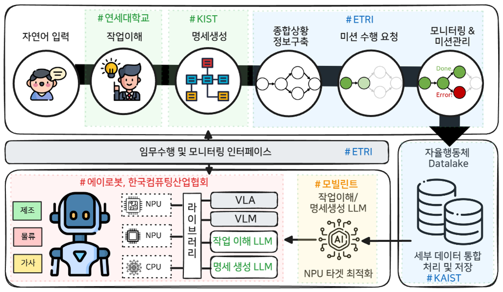
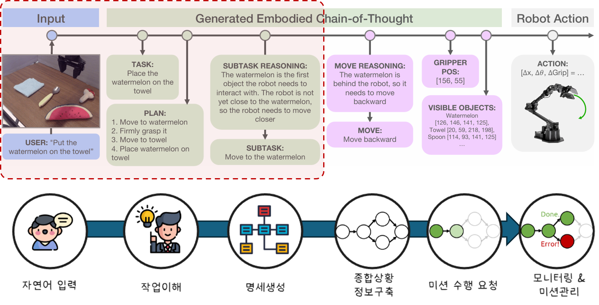
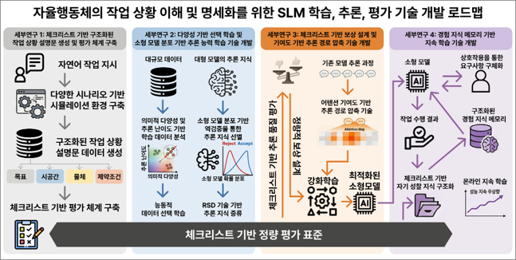
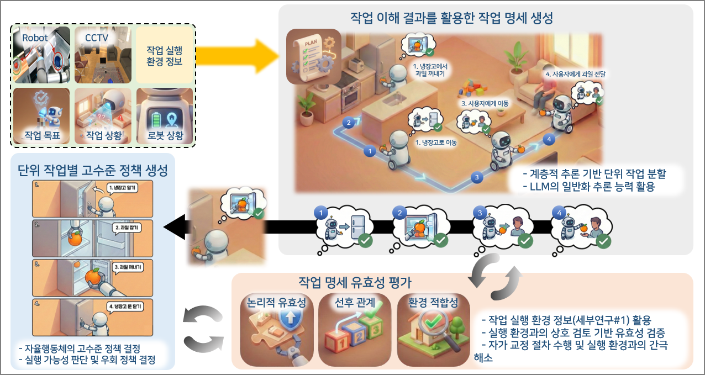
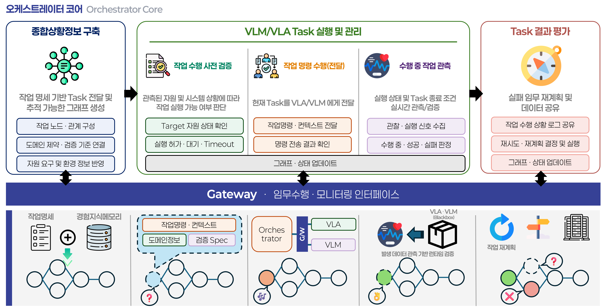

# On-Device Natural Language Processing for High-Speed Task Specification Generation for Autonomous Agents

[한국어](./README.md) · [English](./README.en.md)

---

## 1. Project Overview

> **(Goal)** Develop **on-device natural-language-centric task understanding and task specification generation technology** that enables autonomous agents to understand everyday language and autonomously plan long-horizon tasks.

- **Sub-project 1** of the umbrella project *Core Technology Development for On-Device Application Support of Autonomous Agents*
- Converts user commands into **structured composite task specifications** via experience-knowledge-memory-based context awareness
- Secures on-device technology for **high-speed generation, verification, and execution of specifications on domestic NPUs**
- All deliverables released as **open-source software** (Apache 2.0 / MIT)

| Item | Description |
|---|---|
| Umbrella project | Core Technology Development for On-Device Application Support of Autonomous Agents |
| Sub-project | On-Device Natural Language Processing for High-Speed Task Specification Generation for Autonomous Agents |
| Project ID | RS-2026-25520654 |
| Period | Apr 2026 – Dec 2029 (3 years 9 months) |
| Sponsor / Agency | Ministry of Science and ICT (MSIT) / Institute for Information & Communications Technology Planning & Evaluation (IITP) |
| Type | Development research, TRL 4 → 7, open-source software |

### Participating Organizations

| Role | Organization | Responsibility |
|---|---|---|
| Lead | Electronics and Telecommunications Research Institute (ETRI) | Overall on-device LLM R&D · Orchestration platform · Open-source coordination |
| Partner | Yonsei University | On-device SLM-based task situation understanding · Continual-learning task understanding |
| Partner | Korea Institute of Science and Technology (KIST) | Comprehensive-situation-based task specification generation · Validity reasoning · User evaluation |
| Partner | Mobilint Inc. | NPU compiler & runtime · Model ultra-compression · Memory scheduling |
| Partner | AIROBOT Inc. | Humanoid hardware on domestic AI semiconductors · Demonstration environment |
| Partner | Korea Computing Industry Association (KCIA) | Technology promotion · Demand/market linkage · Demonstration operation · Standardization |
| Subcontract | Korea Advanced Institute of Science and Technology (KAIST) | Integrated data lakehouse |

---

## 2. System Architecture

  
   Overall architecture — pipeline from natural language input to monitoring, with responsible organizations

- Pipeline: **Task understanding (Yonsei) → Specification generation (KIST) → Comprehensive situation construction · Mission execution request · Monitoring/mission management (ETRI)**
- Robot side: NPU-optimized LLM (Mobilint) + humanoid with VLA/VLM libraries (AIROBOT, KCIA)
- Data: integrated processing and storage of sub-project data → **Autonomous Agent Datalake (KAIST)**

---

## 3. Scope of Specification Generation

  
   Scope of this sub-project (dashed box) — the Input ~ SUBTASK span of Embodied Chain-of-Thought[1]. The subsequent MOVE/ACTION span is handled by VLA/VLM

- Scope: **user command understanding + composite task specification generation**
- Core deliverable: a task specification orchestrator that **dispatches sub-tasks (to VLA/VLM) and monitors execution**

| Stage | Function | Owner |
|---|---|---|
| ① Natural language input | Speech/text command reception (STT) | — |
| ② Task understanding | Situation-understanding LLM + experience/knowledge memory → task situation description | Yonsei |
| ③ Specification generation | Composite task specification (PLAN · SubTask) | KIST |
| ④ Comprehensive situation construction | Data structure for specification execution and management | ETRI |
| ⑤ Mission execution request | Dispatch of unit tasks to VLA/VLM/library APIs | ETRI |
| ⑥ Monitoring & mission management | Done/Fail tracking; re-request detailed specification on failure | ETRI |

[1] M. Zawalski et al., "Robotic Control via Embodied Chain-of-Thought Reasoning," CoRL 2024. https://arxiv.org/abs/2407.08693

---

## 4. Research Areas

### Research Area 1 — SLM Training, Inference, and Evaluation for Task Situation Understanding and Specification

  
   Research Area 1 (Yonsei · ETRI) — SLM training, inference, and evaluation roadmap centered on a checklist-based quantitative evaluation standard

- Generation of **structured task situation descriptions** covering task goals, spatio-temporal conditions, and constraints; checklist-based quantitative evaluation framework
- Internalization of task-understanding reasoning via selective mid-training + small-model distribution-matching post-training
- High-speed, lightweight SLM inference via reinforcement learning and reasoning-path compression
- Continual learning without retraining via experience knowledge memory and requirement-completion mechanisms

| AS-IS | TO-BE |
|---|---|
| Internal-reasoning-dependent task understanding — opaque decision basis | Structured description-centric specification (goal · time · space/object · constraints) |
| No intermediate evaluation signal | Checklist-based quality evaluation linked consistently to data, training, and RL rewards |
| Fragmented experience handling · volatile memory — full retraining | Continual learning via experience knowledge memory updates |

### Research Area 2 — Comprehensive-Situation-Based Task Specification Generation and User Experience Evaluation

  
   Research Area 2 (KIST · ETRI) — specification generation from task-understanding results · validity evaluation · high-level policy generation per unit task

- **Long-horizon task specification generation** from task-understanding results + on-device LLM
- **Specification validity reasoning and refinement** through cross-checking with comprehensive situation information (robot · CCTV · task goal/situation/robot state) — logical validity · ordering · environmental fitness
- **High-level policy reasoning** per unit task — feasibility judgment · fallback policy decision
- Composite task execution scenarios · user experience evaluation (SUS)

| AS-IS | TO-BE |
|---|---|
| Rule-based static specifications — limited in unstructured environments | Dynamic specification generation via CoT-based hierarchical reasoning |
| Fixed specifications — lack of flexibility | Validity verification + self-correction to close the plan–execution gap |

### Research Area 3 — Intelligent Orchestration and Model Pipeline Integration Platform

  
   Research Area 3 (ETRI) — Orchestrator core: comprehensive situation construction → VLM/VLA task execution & management → task result evaluation

- **Central control hub** supporting inter-project integration
- **Dynamic reallocation of AI models and heterogeneous NPUs** based on environment, sensors, mission, and resource load (real-time pipeline reconfiguration)
- Lightweight on-device **formal verification** to predict failure of specifications and execution properties in advance
- **Automated feedback**: real-time per-task tracking → problem identification → decision → reconfiguration → execution

| AS-IS | TO-BE |
|---|---|
| Inefficient resource use — static sequential execution | Dynamic scheduling — optimal model/pipeline selection based on state and resources |
| No verification — specifications executed as-is | Execution-property-based formal verification to block risks in advance |
| Post-hoc, log-based monitoring | Automated reconfiguration feedback system |

※ Research Areas 4 (NPU inference SW platform, Mobilint) · 5 (humanoid HW platform, AIROBOT) · 6 (data lakehouse, KAIST) are carried out in conjunction with Areas 1–3 above.

---

## 5. End Products

| # | Deliverable | Research Area | Form |
|---|---|---|---|
| 1 | On-device task understanding and task specification generation engine | 1, 2 | Device-embedded SW |
| 2 | Intelligent orchestration and model pipeline integration platform | 3 | Device-embedded SW |
| 3 | Domain situation information datasets and data lakehouse | 6 | Server-side SW |
| 4 | Integrated on-device system (LLM + VLA + VLM, ≥2 domestic NPUs) | Integration | System (HW + SW) |

**Core Technologies**
- Intelligent orchestration and model pipeline integration platform
- Task situation understanding, specification generation, and evaluation based on domestic AI semiconductors and comprehensive situation information
- Integrated on-device system for autonomous physical AI

---

## 6. Application Areas

| Domain | Application |
|---|---|
| Manufacturing | Human-robot collaborative assembly, inspection, and material handling; flexible-production smart factories responding to process changes via natural language instructions |
| Logistics | Task re-planning and dynamic specification generation in response to on-site changes (e-commerce and logistics) |
| Household | Composite household services such as tidying and cooking assistance; silver care, healthcare, and educational assistance |
| Security & Surveillance | Intelligent security robots and automated CCTV control operable in communication-denied environments |

---

## 7. Open-Source Roadmap

13 software packages and domain-specific datasets released annually under **Apache 2.0 / MIT**

| Year | Open-Source Software | Organization |
|---|---|---|
| 2027 | Task execution verifier SW | ETRI |
| | Task-understanding reasoning SLM SW | Yonsei |
| | NPU-based natural language processing runtime SW | Mobilint |
| | Multimodal data processing SW for situation-specific composite task learning | KAIST |
| | Task specification generation framework for composite task execution by autonomous agents | KIST |
| 2028 | Autonomous agent monitoring SW | ETRI |
| | Composite task learning SW including success, failure, and boundary cases | KAIST |
| | NPU-based task generation model runtime SW | Mobilint |
| | High-speed, lightweight task-understanding SLM SW | Yonsei |
| | Task specification validity reasoning algorithm via cross-checking with comprehensive environment information | KIST |
| 2029 | Orchestration platform SW | ETRI |
| | Long-term-operation task-understanding SLM SW | Yonsei |
| | Sub-project integration SW with data/graph-based management structure | KAIST |

---

## 8. Repositories

---

This work was supported by the Institute for Information & Communications Technology Planning & Evaluation (IITP) grant funded by the Korean government (MSIT) (RS-2026-25520654).

